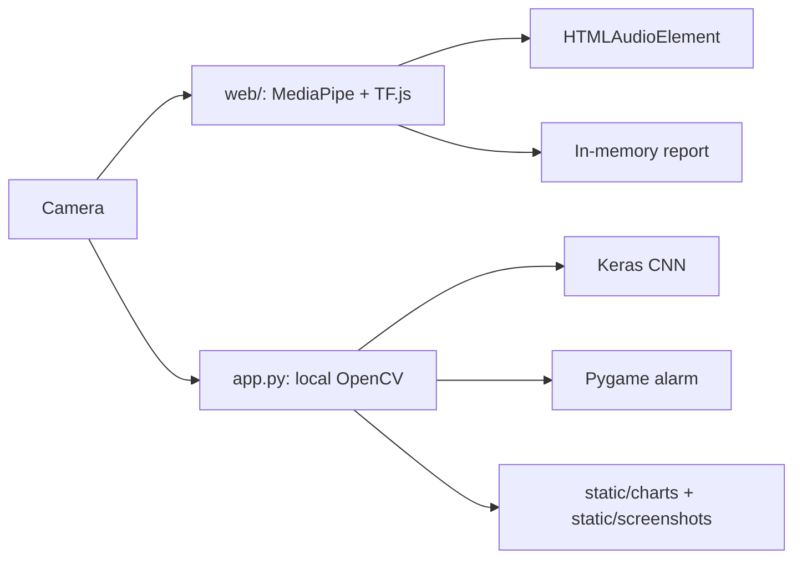

# Browser-first Drowsiness Detection

> A portfolio-ready eye-state monitor that turns a trained Keras CNN and eye geometry into a local, time-thresholded drowsiness alert.

[](https://www.python.org/) [](https://tensorflow.org/) [](LICENSE)

**Live demo:** TODO: replace this link after deploying `/web` to Vercel.

TODO: add a real project screenshot or GIF under `docs/` after capturing one. No demo image is included here because none has been verified.

## Overview

This final-year machine-learning project classifies eye crops as open or closed and applies a continuous closure threshold before raising an alert. The model is a Keras CNN with `64x64x1` grayscale input, pixels scaled by `/255`, and class order `0 = Open`, `1 = Closed` as implemented in the training notebook.

## Two versions

### Browser version (Vercel)

The deployable version is the plain static site in [`web/`](web/). It requests the camera from the browser, localizes eyes with MediaPipe Face Landmarker, runs the converted TensorFlow.js model locally, plays an HTML audio alarm, and keeps session data in memory. It has no server writes and is suitable for Vercel with **Root Directory = `web`**, **Framework Preset = Other**, and no build command.

### Local Flask version

The original desktop workflow remains in [`app.py`](app.py). Flask/OpenCV reads a camera attached to the local machine, Keras performs inference, Pygame plays the local alarm, and Matplotlib writes session outputs to `static/charts/` and `static/screenshots/`.



Vercel cannot run the old server-side design reliably: cloud functions have no user's camera, TensorFlow/OpenCV/Matplotlib exceed the function size budget, Pygame plays on the server rather than the user device, and global state is unsafe for stateless or multi-user functions. Vercel's filesystem is also not a durable place for generated charts or screenshots.

## Features

- CNN and EAR signals shown side by side; choose CNN, EAR, or both (default).
- Continuous closed-eye threshold, default `1.5s`, adjustable from `0.5s` to `3s`.
- Camera selection from `enumerateDevices`, browser audio mute, reports, charts, and canvas screenshots.
- Local-only browser processing: no video upload.

## Model performance

Evaluation uses a fixed, stratified 80/20 split (`random_state=42`) because the dataset has no separate test directory. The verified held-out results are:

| Metric | Value |
| --- | ---: |
| Accuracy | 98.86% |
| Precision | 98.79% |
| Recall | 98.92% |
| F1 | 98.85% |

The corresponding confusion matrix is [`docs/confusion_matrix.png`](docs/confusion_matrix.png). Run:

```text
python evaluate_model.py
```

This writes the reproducible values to `docs/metrics.json` and regenerates the confusion matrix. Training curves are not included because the original executed notebook did not preserve a complete serialised history artifact.

## Limitations

Low light, glasses/reflections, extreme head angles, and camera placement can reduce reliability. The Flask version uses a Haar eye cascade; it often fails to detect closed eyes, so a missing eye is deliberately recorded as **unknown**, not open, but this cannot recover the missed eye. The browser version improves localization with MediaPipe landmarks but is still a research prototype and not a certified safety device.

## Dataset

`Drowsiness_Dataset/` contains `84,898` PNG images in `Close_Eyes/` and `Open_Eyes/`, approximately `328 MB` in this checkout. It is intentionally retained. TODO: add the verified dataset source, attribution, and license before redistribution. Git LFS is recommended for the dataset and model if the repository host's normal file limits are exceeded.

## Project structure

```text
app.py                    Local Flask/OpenCV desktop version
drowsiness_model.h5      Trained Keras model
evaluate_model.py         Reproducible held-out evaluation
train_model.ipynb         Cleaned training/evidence notebook
convert_model.py          Real Keras -> TF.js conversion script
web/                      Static Vercel/browser implementation
static/alarm.wav          Local and browser alarm source
static/charts/            Generated Flask charts (ignored)
static/screenshots/       Generated Flask screenshots (ignored)
docs/                     Verified metrics and portfolio media (TODO)
Drowsiness_Dataset/       Retained local dataset
```

## Local Flask development

```powershell
python -m venv .venv
.venv\Scripts\activate
pip install -r requirements.txt
python app.py
```

Open `http://127.0.0.1:5000`. Set `DROWSINESS_THRESHOLD_SECONDS` to change the default threshold, `LOG_LEVEL` for logging, and `FLASK_DEBUG=1` only when debugging locally.

## Browser development and deployment

The converted browser model is checked in under `web/model/`. To reproduce the conversion, install `tensorflowjs` in a compatible environment and run `python convert_model.py`; on Windows with TensorFlow 2.19, use the isolated compatibility route documented in [`convert_model_colab.ipynb`](convert_model_colab.ipynb). Then serve the static directory (camera APIs require a secure context):

```text
npx serve web
```

Open the printed URL, allow the camera, and click **Start monitoring**. Import the `web/` folder into Vercel with no build command.

## Development notes

I researched dataset preparation, implemented and trained the CNN, debugged the local detection flow, and made the design decisions around preprocessing, timing, browser privacy, and dual signals. Assistance and code suggestions were used during development, but claims in this README are limited to behavior and evidence that can be inspected in this repository.

## Future improvements

- Add yawning detection and head-pose estimation.
- Improve multi-face handling and tracking stability.
- Add a PWA/offline mode once model assets are verified.

## License

MIT. See [`LICENSE`](LICENSE).
